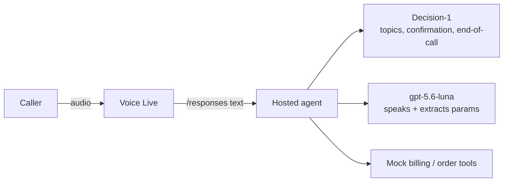

# Telecom voice call center on Microsoft Foundry Hosted Agents

Two variants of the same scenario — a customer calls a telecom provider about **billing** or **order status** —
built with **Microsoft Agent Framework (Python)**, hosted as **Foundry Hosted Agents** (Responses protocol),
reached in real time through **Voice Live**, and routed by **Microsoft-Decision-1**. Conversation model: `gpt-5.6-luna`.
Authentication is **Entra ID only** (`DefaultAzureCredential`); no keys.

| | [`handoff-agent`](src/handoff-agent) | [`background-agent`](src/background-agent) |
|---|---|---|
| Who talks to the customer | A router greets, then the **billing / orders sub-agent takes over the call**, then control returns to the router | **One foreground agent always talks**; billing / orders workers run silently in the background |
| Routing | Decision-1 picks the sub-agent; a Decision-1 guard runs on every sub-agent turn (resolved / drifted / wants to end) | Decision-1 detects the topics → foreground **reads them back and asks for confirmation** → workers start only on "yes" |
| Two topics in one sentence | First is handled, second is queued and offered after closure | Both confirmed together, run in parallel, results delivered one at a time |



Decision-1 (`POST {account}/providers/microsoft/v1/systemone`) answers typed questions (`noul` yes/no with confidence,
`choice`) in one request per turn. **Code decides the routing; the LLM only speaks.** If Decision-1 is slow or fails, the
agents fall back to safe defaults. Tools are mocked (`tools/`).

## Layout

```
azure.yaml                 azd manifest (2 hosted agents)
src/handoff-agent/         main.py, host_agent.py, orchestrator.py, sub_agents/, tools/, decision.py, tests/
src/background-agent/      main.py, foreground.py, task_store.py, workers/, tools/, decision.py, tests/
client/voicelive_client.py Voice Live console client (audio or --text)
src/web-app/               Test/showcase web app for Azure Container Apps (FastAPI + static UI, infra/, deploy.ps1)
```

Each agent folder is self-contained. `decision.py` and `voice_server.py` are intentionally duplicated.
`voice_server.py` subclasses `ResponsesHostServer` because Voice Live sends an empty `input` and stores the utterance in the
conversation; the subclass reads the latest user message from the conversation history in that case.

## Setup (uv only)

Python and packages are managed with [uv](https://docs.astral.sh/uv/). Every `pyproject.toml` contains:

```toml
[[tool.uv.index]]
name = "msiopypi"
url = "https://pkgs.dev.azure.com/ms-feed-12/1es-public/_packaging/pypi-public/pypi/simple/"
default = true
```

```powershell
cd src\handoff-agent        # or src\background-agent
uv sync
copy .env.example .env      # FOUNDRY_PROJECT_ENDPOINT, AZURE_AI_MODEL_DEPLOYMENT_NAME, DECISION_DEPLOYMENT_NAME
az login
uv run pytest               # unit tests (no network)
uv run python main.py       # serves the Responses protocol on :8088 (or $PORT)
```

## Deploy to Foundry (azd)

Target: project `swc-project` on account `flopes-swc-foundry` (rg-foundry, swedencentral).

```powershell
azd env new voice-agents
azd env set AZURE_AI_PROJECT_ID <project resource id>
azd env set AZURE_AI_PROJECT_ENDPOINT https://flopes-swc-foundry.services.ai.azure.com/api/projects/swc-project
azd env set FOUNDRY_PROJECT_ENDPOINT https://flopes-swc-foundry.services.ai.azure.com/api/projects/swc-project
azd env set AZURE_AI_MODEL_DEPLOYMENT_NAME gpt-5.6-luna
azd env set AZURE_TENANT_ID <tenant>; azd env set AZURE_SUBSCRIPTION_ID <sub>; azd env set AZURE_RESOURCE_GROUP rg-foundry
azd deploy --no-prompt      # or: azd deploy handoff-agent --no-prompt
```

Notes:

- The remote build uses `requirements.txt`; `.agentignore` excludes `uv.lock` so it is not used. **After changing
  dependencies, regenerate it in each agent folder:**
  `uv export --no-hashes --no-emit-project --no-dev --no-header --no-annotate -o requirements.txt` (strip any `--index-url` line).
- `azd ai agent init` does not work against an already-provisioned project; use `azd env set` as above.
- **RBAC:** each hosted agent runs as its own instance identity. Grant it **Cognitive Services User** on the Foundry
  account (needed to call Decision-1) and allow a few minutes for propagation. Without it Decision-1 returns 401 and
  the agent silently uses its fallbacks.
- Smoke test: `azd ai agent invoke handoff-agent "I have a question about my bill"` (consecutive calls share a session;
  `--new-session` resets). Logs: `azd ai agent monitor <service> --type console`.

## Talk to it with Voice Live

```powershell
cd client
uv sync
uv run python voicelive_client.py --agent-name handoff-agent --text        # type lines on stdin/prompt; replies are printed
uv sync --extra audio                                                       # microphone + speaker (pyaudio)
uv run --extra audio python voicelive_client.py --agent-name background-agent
```

Your identity needs the **Azure AI User** role on the project. Text mode was verified end to end against both deployed
agents; the microphone path uses the same session and was not exercised in the build environment.

## Web app: test and showcase the agents

`src/web-app` is a debugging/showcase UI: pick an agent, pick a sample conversation (or type), chat by text or voice,
and watch the trace for that session next to the conversation.

```
browser ──ws──▶ FastAPI (ACA, managed identity) ──Voice Live──▶ hosted agent (handoff-agent / background-agent)
   ▲                  │
   └── trace events ◀─┴── tails the agent's console log stream (TRACE {json} lines) for that session
```

- **Agents and samples:** 6 sample conversations per agent (multi-topic, topic switch, out-of-scope, order not shipped,
  ...). Click a sample, then **Send next**, **Run all**, or click any line to send it.
- **Text or voice:** the session always uses Voice Live with server VAD, echo cancellation and noise reduction. The mic
  button streams audio; "Speak replies" plays the agent's voice. Both can be mixed in one session.
- **Trace panel** (filterable, expandable rows, JSON download): `voice` (first token / first audio / response.done
  latency and tokens), `agent` (turn start/end, Decision-1 calls and probabilities, handoffs, tool calls with
  args/results, background `phase` and `task.*`), `system` (container state) and raw container `log` lines (off by default).
  Agents emit these as `TRACE {json}` log lines via `calltrace.py`; the web app parses them from
  `GET {project}/agents/{agent}/sessions/vl_{voiceSessionId}:logstream`.
- Timestamps come from two machines, so ordering between `voice` and `agent` events can differ by a little clock skew.
  The first turn of a session includes the agent container cold start (about 10 s).

Run locally (uses your `az login`; needs **Azure AI User** + **Cognitive Services User** on the account):

```powershell
cd src\web-app
uv sync
uv run uvicorn app:app --port 8080     # http://localhost:8080
uv run pytest
```

Deploy to Azure Container Apps (creates `rg-voice-tester`: ACR, Log Analytics, ACA environment, user-assigned identity
with `AcrPull` and the two Foundry roles; builds the image in ACR; enables Entra sign-in for the current tenant):

```powershell
cd src\web-app
.\deploy.ps1                 # -SkipAuth only for a private throw-away test
```

Sharing the URL: sign-in is required (single-tenant Entra app registration `voicetester-web`), so anyone in the tenant can
open it. Everyone who uses it drives your agents with the app's identity, so treat access as access to the project.
Secrets: the app registration's client secret is stored as a Container App secret and rotates each time `deploy.ps1` runs.
Smoke test the deployment without going through sign-in:
`az containerapp exec -g rg-voice-tester -n voicetester-app --command "python selftest.py handoff-agent"`.
The browser needs HTTPS for the microphone (ACA provides it); the mic path was not exercised in the build environment.

## Known limitations

- The web app keeps sessions in memory (max 10 concurrent per replica, 30 minutes each).
- Background tasks and per-call state live in container memory (a restart drops them) — fine for a demo.
- `background-agent` proposes a new lookup for a follow-up question instead of answering from earlier results.
- Cloud logs show harmless `No module named 'agents'` / "A365 OpenAI Agents instrumentation" telemetry lines.
- Alternative wiring: let `azd` create a Voice Live wrapper agent (`conversationEngine.type: hosted_agent`) instead of
  connecting the client directly.
