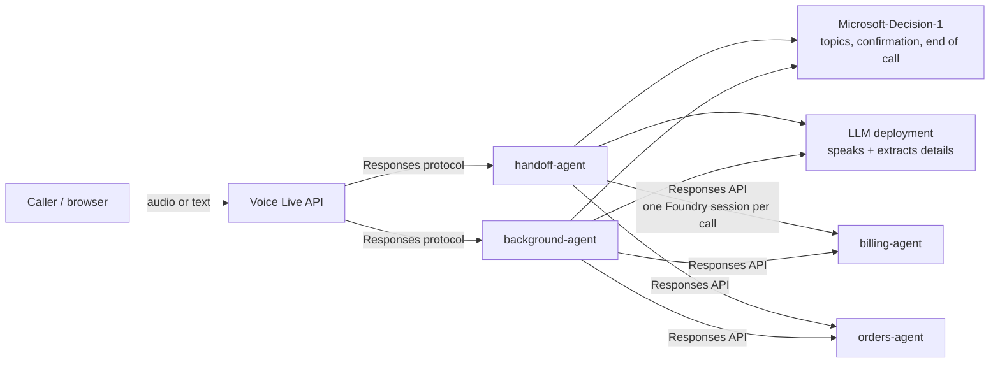

# Telecom voice call center on Microsoft Foundry Hosted Agents

A reference implementation of a **real-time, multi-agent voice call center** on Microsoft Foundry.

A customer calls a telecom provider about **billing** or **order status**. A single entry-point agent listens,
works out what the customer wants, **confirms it back to them**, and only then involves the right specialist.
Everything runs as **Foundry Hosted Agents** written with **Microsoft Agent Framework (Python)**, is reached in real
time through the **Voice Live API**, and uses **Microsoft-Decision-1** to decide routing (topics, confirmation,
"that's all, goodbye"). Authentication is **Microsoft Entra ID only** — there are no keys anywhere.

The repo ships two variants of the same scenario so you can compare the patterns, plus a **web app** (Azure Container
Apps) to test them by text or by voice while watching the traces.

| Component | What it is | Where |
|---|---|---|
| `handoff-agent` | Orchestrator, **handoff pattern**: a router greets, confirms the topics, hands the call to a specialist that talks to the customer, then takes it back | [`src/handoff-agent`](src/handoff-agent) |
| `background-agent` | Orchestrator, **foreground/background pattern**: one foreground agent always talks; specialists run silently as background tasks and the foreground reads the results | [`src/background-agent`](src/background-agent) |
| `billing-agent` | Hosted **sub-agent** for billing questions (Responses API) | [`src/billing-agent`](src/billing-agent) |
| `orders-agent` | Hosted **sub-agent** for order status (Responses API) | [`src/orders-agent`](src/orders-agent) |
| Web app | Test/showcase UI with sample conversations, voice, and live traces | [`src/web-app`](src/web-app) |
| Console client | Minimal Voice Live client (text or microphone) | [`client`](client) |

The billing and orders tools are **mocked** (see `tools/` in each agent); swap them for your real systems.

## Architecture



Key design points:

- **Code decides the routing; the LLM only speaks.** Decision-1 (`POST {account}/providers/microsoft/v1/systemone`)
  answers typed questions (`noul` yes/no probability, `choice`) in one request per turn. Each question is told to look
  at the customer's *latest* message, so earlier turns are context only. If Decision-1 is slow or fails, the agents
  fall back to safe defaults.
- **Confirm before acting.** When the customer asks for something, the agent reads it back ("I understood you want the
  status of order 12345 and your last invoice — is that right?"). One Decision-1 call classifies the reply as
  `yes`, `amend` (a detail was corrected, e.g. "the order is 3472" — keep every topic and re-confirm), `no`
  (rejected or a topic dropped) or `neither` (ask again). Both orchestrators implement the same logic.
- **Sub-agents are separate hosted agents.** The orchestrators call `billing-agent` and `orders-agent` over the
  Responses API. The first call creates a Foundry session; later calls reuse it (`agent_session_id`), so the
  specialist keeps its context across turns (see
  [Manage hosted agent sessions](https://learn.microsoft.com/azure/foundry/agents/how-to/manage-hosted-sessions)).
  `SUBAGENT_MODE=local` runs them in-process instead.
- **Voice Live in agent mode.** Voice Live does speech-to-text, noise suppression, echo cancellation, voice-activity
  detection and text-to-speech; the hosted agent is the brain. The caller can interrupt the agent (server-side
  barge-in). The language/locale is forced to `pt-PT` by the web app (configurable, see below).

## Prerequisites

**Azure**

- An Azure subscription and a **Microsoft Foundry resource with a project** in a region that supports
  **Hosted Agents** and **Voice Live** (the reference deployment uses Sweden Central). Hosted Agents are in preview.
- Two **model deployments** in that Foundry resource:
  1. A chat model for the agents' replies — the code defaults to a deployment named **`gpt-5.6-luna`** (any chat
     deployment works; set its name in `AZURE_AI_MODEL_DEPLOYMENT_NAME`, see step 2).
  2. **Microsoft-Decision-1**, deployed with the **deployment name `Decision-1`** (the default of
     `DECISION_DEPLOYMENT_NAME`). See [Deploy and use Microsoft-Decision-1](https://learn.microsoft.com/azure/foundry/foundry-models/how-to/use-foundry-models-microsoft-decision).
- Permissions for **you**:
  - Deploying the agents: able to create hosted agents in the project (e.g. *Foundry User* / contributor on the project).
  - Granting the roles in step 3 and deploying the web app: **Owner**, or **Contributor + User Access Administrator**,
    on the Foundry resource group and on the web-app resource group.

**Tools on your machine**

| Tool | Why |
|---|---|
| [Azure CLI](https://learn.microsoft.com/cli/azure/install-azure-cli) (`az`) | roles, web-app deployment |
| [Azure Developer CLI](https://aka.ms/azd) `azd` **>= 1.27.1** with the `azure.ai.agents` extension (`azd extension install azure.ai.agents`) | deploying the hosted agents |
| [uv](https://docs.astral.sh/uv/) | Python and dependency management (Python 3.13 is installed by uv) |
| PowerShell 7+ (or Windows PowerShell) | `src/web-app/deploy.ps1` |

No local Docker is needed: the agents are built remotely by Foundry and the web-app image is built in Azure Container Registry.

> **About the package index.** Every `pyproject.toml` pins uv to the `msiopypi` feed
> (`https://pkgs.dev.azure.com/ms-feed-12/1es-public/_packaging/pypi-public/pypi/simple/`, `default = true`).
> If that feed is not reachable from your network, delete the `[[tool.uv.index]]` block from each `pyproject.toml`
> (and re-run `uv lock`) to fall back to PyPI.

## Deploy to Azure

The deployment has three parts: **(1)** the four hosted agents, **(2)** role assignments, **(3)** the web app.

### 0. Get the code and sign in

```powershell
git clone <this-repo-url>
cd hosted-agent-voice-orchestrator
az login
azd auth login
```

### 1. Collect your Foundry details

You need the following values (Azure portal → your Foundry resource, or `az cognitiveservices account list`):

| Value | Example |
|---|---|
| Subscription ID / tenant ID | `az account show` |
| Foundry resource group | `rg-foundry` |
| Foundry account (resource) name | `my-foundry` |
| Project name | `my-project` |
| Project resource ID | `/subscriptions/<sub>/resourceGroups/rg-foundry/providers/Microsoft.CognitiveServices/accounts/my-foundry/projects/my-project` |
| Project endpoint | `https://my-foundry.services.ai.azure.com/api/projects/my-project` |
| Chat model deployment name | `gpt-5.6-luna` |

### 2. Deploy the four hosted agents with `azd`

The repo's `azure.yaml` defines four hosted agents (`handoff-agent`, `background-agent`, `billing-agent`,
`orders-agent`). Point `azd` at your **existing** project (no infrastructure is created by this step — the agents are
published into the project):

```powershell
azd env new voice-agents                                  # any environment name
azd env set AZURE_SUBSCRIPTION_ID  <subscription-id>
azd env set AZURE_TENANT_ID        <tenant-id>
azd env set AZURE_RESOURCE_GROUP   <foundry-resource-group>
azd env set AZURE_LOCATION         <region, e.g. swedencentral>
azd env set AZURE_AI_PROJECT_ID    <project resource id>
azd env set AZURE_AI_PROJECT_ENDPOINT  <project endpoint>
azd env set FOUNDRY_PROJECT_ENDPOINT   <project endpoint>
azd env set AZURE_AI_MODEL_DEPLOYMENT_NAME <chat model deployment name>

azd deploy billing-agent orders-agent handoff-agent background-agent --no-prompt
```

Each agent takes about a minute (Foundry builds it remotely from `requirements.txt`). When it finishes, `azd` stores
each agent's instance identity in the environment (`AGENT_<NAME>_INSTANCE_IDENTITY_PRINCIPAL_ID`), which step 3 uses.

> `azd ai agent init` is intended for new projects and does not work against an already-provisioned one; that is why
> the environment is populated with `azd env set` above.

### 3. Grant the agents access (RBAC)

Each hosted agent runs under its own **instance identity**. The two orchestrators need:

| Role | Scope | Why |
|---|---|---|
| **Cognitive Services User** | Foundry account | call Decision-1 |
| **Foundry User** (formerly *Azure AI User*) | Foundry project (or account) | invoke `billing-agent` / `orders-agent` |

`billing-agent` and `orders-agent` need no extra roles. Run (PowerShell):

```powershell
$account = "/subscriptions/<sub>/resourceGroups/<foundry-rg>/providers/Microsoft.CognitiveServices/accounts/<account>"
$project = "$account/projects/<project>"

foreach ($agent in "HANDOFF_AGENT", "BACKGROUND_AGENT") {
  $principal = azd env get-value "AGENT_${agent}_INSTANCE_IDENTITY_PRINCIPAL_ID"
  az role assignment create --assignee-object-id $principal --assignee-principal-type ServicePrincipal `
    --role "Cognitive Services User" --scope $account
  az role assignment create --assignee-object-id $principal --assignee-principal-type ServicePrincipal `
    --role "Foundry User" --scope $project
}
```

Role assignments take a few minutes to propagate. **Without the first role, Decision-1 returns 401 and the agents
silently fall back to defaults** (poor routing, but no crash); without the second, the orchestrators cannot call
the sub-agents.

### 4. Smoke-test the agents

```powershell
azd ai agent invoke handoff-agent "Hi, I have a question about my bill"
azd ai agent invoke background-agent "Where is my order 12345?"
azd ai agent monitor handoff-agent --type console        # live container logs
```

Consecutive invocations share a session; use `--new-session` to reset it.

### 5. Deploy the web app to Azure Container Apps

The web app lets you (or anyone you share the URL and password with) chat or talk to both agents and see the
traces. `deploy.ps1` creates a resource group with Azure Container Registry, Log Analytics, a Container Apps
environment and a user-assigned managed identity (given **Foundry User** and **Cognitive Services User** on your
Foundry account), builds the image in ACR, and deploys the container app. It is safe to re-run.

```powershell
cd src\web-app
.\deploy.ps1 `
  -FoundryResourceGroup <foundry-rg> `
  -FoundryAccountName   <account> `
  -FoundryProjectName   <project> `
  -Location             <region> `
  -AppPassword          '<a strong password>'
```

| Parameter | Default | Notes |
|---|---|---|
| `-ResourceGroup` | `rg-voice-tester` | created by the script |
| `-Location` | `swedencentral` | region for the web-app resources |
| `-NamePrefix` | `voicetester` | prefix for the resource names |
| `-FoundryResourceGroup` / `-FoundryAccountName` / `-FoundryProjectName` | the author's project | **always override these** |
| `-AppPassword` | `voicedemo` | **always override this**; stored as a Container Apps secret |

The script prints the app URL when it finishes. Open it and sign in with the password. To change the password later,
re-run the script with a new `-AppPassword`.

> **Security.** The app is protected only by the shared password and acts with the app's managed identity: anyone who
> knows the password can drive your agents. Use a strong password, share it sparingly, and treat it as access to the
> project. Login sets a signed, HttpOnly, 12-hour cookie and throttles repeated failures.

Optional smoke test of the deployed app:

```powershell
az containerapp exec -g rg-voice-tester -n voicetester-app `
  --command "python selftest.py handoff-agent 8000 order-tracking"
```

### 6. Try it

1. Open the app URL and sign in.
2. Pick an agent (**handoff** or **background**) and **Text** or **Voice**.
3. Optionally load a sample conversation (e.g. *bill and order in one sentence*, *correct the order number*,
   *two orders in a row*) — loading a sample does not start anything.
4. Press **Start session**. Input stays locked until the agent is connected and has greeted you.
5. Chat or speak (the browser needs HTTPS and microphone permission — Container Apps provides HTTPS). Watch the
   **Trace**, **Decision-1** and **Usage** tabs on the side.

## Using the web app

- **Two experiences.** *Text* is a normal chat. *Voice* is speak-and-listen with a status orb (listening / hearing /
  thinking / speaking); you can interrupt the agent while it talks. Choose the TTS **voice and style** in the header
  (styles are offered only when the voice supports them; the list lives in `src/web-app/voices.py`). The **locale is
  always forced to `pt-PT`**, so voices built for other languages still speak Portuguese.
- **Sample conversations** are the same for both agents (written in European Portuguese): multi-topic requests, topic
  switch, correction of a detail, missing order number, out-of-scope, two consecutive orders, and more. In text mode
  click a line, **Send next**, or **Run all**; in voice mode the next line is highlighted as a script.
- **Visual flow.** Handoff: an animated graph of Router / Billing / Orders. Background: a phase stepper
  (Idle / Proposing / Running) and a task board.
- **Decision-1 tab.** One card per call with the conversation sent, the questions, the answers against their
  thresholds, latency, and the raw request/response.
- **Usage tab.** Tokens, calls and estimated cost per model for the session (the **Pricing** button edits the rates;
  Voice Live speech cost is not included).
- **Trace tab.** Filterable events (`voice`, `agent`, `system`, raw `log`) with JSON export. The **copy JSON** button
  puts the session's full trace on the clipboard — attach it to bug reports.
- **Microphone.** The header has a mic selector and an *echo cancel* box. A software gain in the mic worklet
  normalises quiet microphones (e.g. Bluetooth headsets); `?gain=0` in the URL disables it.

Traces come from the agents as `TRACE {json}` log lines (`calltrace.py`); the web app reads them from the agent's
session log stream for that voice session.

## Routing policy (per session)

The **Routing policy** panel (left column, above the samples) lets the person running the call centre decide, for the
next session, what happens with each topic. Pick a preset or set each topic yourself; the choice is remembered in the
browser and locked while a session is running.

| Route | Billing / Order status | Other (anything else) | What the caller hears |
|---|---|---|---|
| `ai_agent` | yes | no | The hosted specialist answers |
| `human` | yes | yes | "I'm transferring you to a human operator" and the call ends |
| `decline` | yes | yes (default) | "I can't help with that on this call" and the call continues |

Rules, identical in both agents:

- **Mixed requests.** If the caller asks something the AI can answer and something routed to a human, the AI topics
  are answered first and the human transfer comes last. The plan is still confirmed first, including the transfer.
- **Declined topics** are stated as unavailable; the caller can ask for something else.
- **"I want a person"** (Decision-1 `wants_human` at least 0.7) transfers immediately, with no confirmation and
  regardless of the policy. `background-agent` first waits for tasks that are still running.
- **Topic classification.** Decision-1 now also asks `other` (is this neither billing nor orders?) and `wants_human`.
  The policy is enforced in code; the LLM only voices the outcome.
- **The human transfer is a mock.** `HandoffService` emits a `human.handoff` trace with the reason, topics, extracted
  order ids and a summary — the payload a real contact-centre integration would receive.

The web app sends the policy when the session starts (`/ws/session?policy=…`). The orchestrator receives it in the
first message of the call (`[call connected]` followed by `[policy] {json}`), snapshots it in its call state and stores
it in the Foundry conversation. In this POC the policy is trusted as sent; a production system should fetch it
server-side from an admin-controlled store keyed by the call. New samples (`policy-*`) exercise each case.

## Configuration reference

**Agents** (set in `azure.yaml` under each service's `env:`; local defaults in each `.env.example`)

| Variable | Default | Meaning |
|---|---|---|
| `FOUNDRY_PROJECT_ENDPOINT` | (set by the platform when hosted) | project endpoint |
| `AZURE_AI_MODEL_DEPLOYMENT_NAME` | `gpt-5.6-luna` | chat model deployment |
| `DECISION_DEPLOYMENT_NAME` | `Decision-1` | Decision-1 deployment name |
| `SUBAGENT_MODE` | `remote` | `remote` = call the hosted sub-agents; `local` = in-process |
| `BILLING_AGENT_NAME` / `ORDERS_AGENT_NAME` | `billing-agent` / `orders-agent` | names of the hosted sub-agents |
| `SUBAGENT_USER_DELEGATION` | `false` | handoff only: send `x-ms-user-identity` to sub-agents (experimental) |
| `APPLICATIONINSIGHTS_CONNECTION_STRING` | empty | optional telemetry |

**Web app** (set by `infra/main.bicep`; override with container app env vars)

| Variable | Default | Meaning |
|---|---|---|
| `APP_PASSWORD` | (secret) | shared password |
| `VOICELIVE_ENDPOINT` | `https://<account>.services.ai.azure.com` | Voice Live endpoint |
| `FOUNDRY_PROJECT_NAME` / `FOUNDRY_PROJECT_ENDPOINT` | from deploy parameters | target project |
| `STT_LANGUAGE` | `pt-PT,en-US` | speech-to-text languages |
| `VAD_TYPE` / `VAD_LANGUAGES` | `azure_semantic_vad_multilingual` / `pt,en` | turn detection |
| `MAX_SESSIONS` / `MAX_SESSION_SECONDS` | `10` / `1800` | per-replica limits |

Decision-1 thresholds live in each agent's `decision.py` (`TOPIC_THRESHOLD`, `CONFIRM_THRESHOLD`, `END_THRESHOLD`, ...).

## Develop locally

```powershell
# An agent (uses your az login; needs Cognitive Services User + Foundry User on the account/project)
cd src\handoff-agent                 # or src\background-agent, src\billing-agent, src\orders-agent
uv sync
copy .env.example .env               # fill in FOUNDRY_PROJECT_ENDPOINT etc.
uv run pytest                        # unit tests, no network
uv run python main.py                # Responses protocol on :8088 (or $PORT)

# The web app
cd src\web-app
uv sync
$env:APP_PASSWORD = 'dev'
uv run uvicorn app:app --port 8080   # http://localhost:8080
uv run pytest

# Console Voice Live client
cd client
uv sync
uv run python voicelive_client.py --agent-name handoff-agent --text
uv sync --extra audio                # microphone + speaker (pyaudio)
```

The remote agent build uses each agent's `requirements.txt` (`.agentignore` keeps `uv.lock` out). **After changing
dependencies, regenerate it** in that agent folder and delete any `--index-url` line it contains:

```powershell
uv export --no-hashes --no-emit-project --no-dev --no-header --no-annotate -o requirements.txt
```

## Repository layout

```
azure.yaml                 azd manifest (4 hosted agents)
src/handoff-agent/         main.py, host_agent.py, orchestrator.py, remote_runner.py, sub_agents/, tools/, decision.py, tests/
src/background-agent/      main.py, foreground.py, task_store.py, remote_workers.py, workers/, tools/, decision.py, tests/
src/billing-agent/         hosted billing specialist (Responses API)
src/orders-agent/          hosted order-status specialist (Responses API)
src/web-app/               FastAPI app + static UI, infra/ (Bicep), deploy.ps1, samples, selftest
client/voicelive_client.py Voice Live console client
```

Each agent folder is self-contained; `decision.py`, `calltrace.py`, `routing_policy.py` and `voice_server.py` are intentionally duplicated.
Voice Live sends an empty `input` and stores the utterance in the conversation, so `voice_server.py` subclasses
`ResponsesHostServer` to read the latest user message from the conversation history.

## How the two patterns differ

| | `handoff-agent` | `background-agent` |
|---|---|---|
| Who talks | Router greets and confirms; the **specialist answers the customer directly**; control returns to the router | **One foreground agent always talks**; specialists work silently |
| Routing | Decision-1 picks topics; a confirmation check reads yes/amend/no; a guard runs on each specialist turn | Decision-1 detects topics; the foreground reads them back; workers start only on "yes" |
| Two topics at once | Confirmed together, answered one after another in a single turn | Confirmed together, run in parallel, results delivered one at a time |

Any change to the conversation flow should be made, tested and deployed for **both** orchestrators so they stay in step.

## Troubleshooting

| Symptom | Likely cause / fix |
|---|---|
| Agent works but routing is poor; logs show Decision-1 `401`/`403` | Missing **Cognitive Services User** on the account for the orchestrator's instance identity (step 3); wait a few minutes after assigning |
| Sub-agent calls fail with `403` / "not authorized" | Missing **Foundry User** on the project for the orchestrator (step 3) |
| Sub-agent calls fail with a user-id / `x-agent-user-id` error | `caller_scope.py` must be imported by `billing-agent` and `orders-agent` (it is by default); redeploy them |
| Decision-1 `404` / model not found | The deployment name is not `Decision-1`; set `DECISION_DEPLOYMENT_NAME` in `azure.yaml` and redeploy |
| `azd deploy` fails resolving dependencies | Regenerate `requirements.txt` (see above) and make sure it has no `--index-url` line |
| Web app: "session is starting" never finishes | First turn includes the agent's cold start (about 10 s); if it persists, check the web app's identity roles and `azd ai agent monitor <agent> --type console` |
| Voice: speech is not recognised | Check the mic selector; quiet headsets rely on the software gain (see `src/web-app/static/mic-worklet.js`); the VAD threshold is in `src/web-app/session.py` |
| `uv sync` cannot reach the package feed | See the package-index note under Prerequisites |

Cloud logs may show harmless `No module named 'agents'` / "A365 OpenAI Agents instrumentation" lines.

## Known limitations

- Demo-grade state: web-app sessions, background tasks and per-call state live in container memory (a restart drops
  them); the web app allows 10 concurrent sessions per replica, 30 minutes each.
- Hosted sub-agent sessions expire after 15 idle minutes; the orchestrators transparently start a new one and emit a
  `subagent.session_lost` trace.
- `background-agent` proposes a new lookup for a follow-up question instead of answering from earlier results.
- `caller_scope.py` in the sub-agents monkeypatches a private hosting-library API so agent-to-agent calls (which carry
  no end user) are accepted; re-check it when upgrading `agent-framework-foundry-hosting`.
- The routing policy is client-supplied and not authenticated beyond the web-app login; the human transfer is a mock.
  In `handoff-agent`, a call that was transferred to a human resets if the caller keeps talking.
- The microphone path is browser-only and depends on your device; Bluetooth headsets in particular vary.
